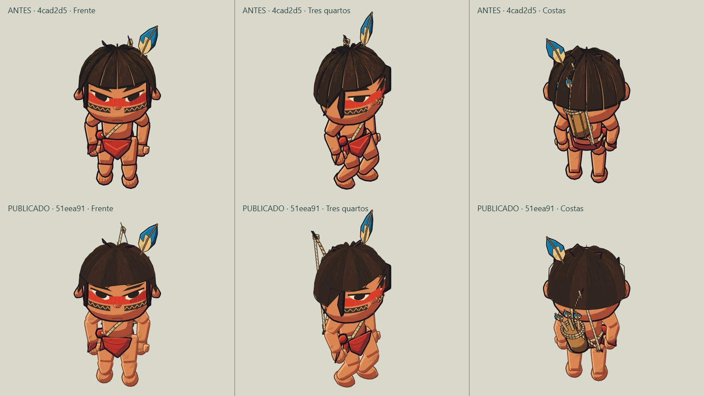
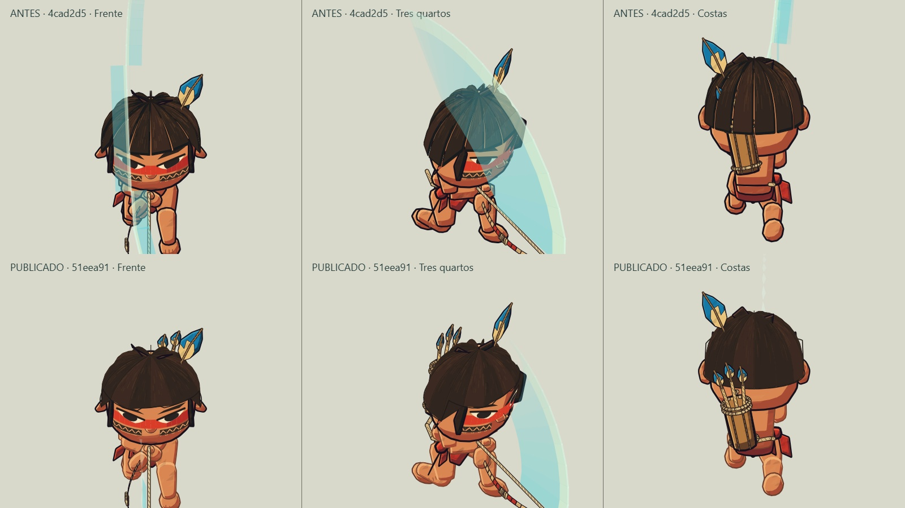

# Auditoria do impacto da meta — pedido do autor

O autor abriu diretamente D:/.GITHUB/games/game-2d-aruan/index.html e percebeu pouca diferença. Ele abriu o arquivo correto. A avaliação visual confirma: o ganho da tela parada é pequeno, apesar de correções importantes no personagem e no comportamento. A contagem de sprints/testes/capturas não deve ser usada como medida do salto de arte.

## Index e versão efetivamente carregada

- index.html foi atualizado desde 4cad2d5: controles de toque, instruções/gamepad, acessibilidade e carregamento de js/appearance.js.
- O desenho do personagem e suas animações são implementados nos arquivos JS carregados pelo index. A data do HTML não precisa acompanhar cada alteração desses arquivos.
- Testado o caminho exato aberto pelo autor, file:///D:/.GITHUB/games/game-2d-aruan/index.html, em Chrome headless: render1600×900, idleBlink/Appearance/pollGamepad presentes, zero erros de console/rede.
- Testado também via servidor local próprio: index atualizado, Cache-Control:no-store e head.js servido idêntico ao arquivo da working tree. Isso não demonstra o conteúdo de uma aba já aberta no navegador do autor; confirma o encadeamento dos arquivos corretos.
- Até o pedido, origin/master estava em51eea91. O ajuste pequeno de contorno7d5e41a estava local e ainda não enviado; foi checkpointado e publicado emba1252d. Essa diferença pequena não explica a pouca mudança global percebida.

## Antes/depois controlado

As duas imagens abaixo foram renderizadas com o código real de4cad2d5 e51eea91 em funções isoladas, usando o mesmo viewport1600×900, projeção, escala, direções e preset original. Não foi feita edição da arte ou troca de roupa para aumentar o contraste. A comparação de combate usa o mesmo ataque, amostrado no trecho ativo em1/120s; são correções do mesmo gesto, não uma nova mecânica.

| Área | Antes → depois | Impacto para quem testa o index |
|---|---|---|
| Cabelo/rosto | Sulcos escuros e expressão mais rígida → massa de cabelo mais contínua, olhos/sobrancelhas refinados | Visível em close; discreto no personagem pequeno |
| Pele e extremidades | Contornos segmentados e juntas rígidas → junções contínuas, mãos/pés arredondados e sombras mais leves | Melhora perceptível na grade ampliada; pouca mudança na tela inteira |
| Arco/aljava/flechas | Equipamento próximo/atravessando o volume da cabeça em poses → fixação posterior inclinada e clearance revisado | Uma das diferenças visuais mais claras nas costas e durante golpes |
| Rastro do finalizador | Faixa atravessando cabelo/rosto → brilho externo sem cobrir a cabeça | Diferença clara durante o terceiro golpe, ausente numa captura parada |
| Movimento/transições | Deslizamento, impulso residual, reversão e cortes de pose → apoios estáveis, frenagem e transições controladas | Deve ser sentido ao andar, inverter, rolar e cancelar; não aparece parado |
| Combo/inputs | Intenções perdidas e limitações de foco → buffer/cancelamento e teclado/toque/gamepad com handoff | Funcional, não redesenha o personagem |
| Piscada | Olhos sempre abertos → fechamento120ms a cada4,8s no idle | Pequena, fácil de não notar e ausente na maior parte dos frames |
| Personalização | Catálogo inexistente → presets/cores/JSON no estúdio | Opcional: o original continua padrão; só muda o campo ao salvar a escolha |
| Pausa/estabilidade | Repinturas redundantes e buffers frágeis → cache de frame/recuperação | Engenharia, sem mudança intencional de arte |

## O que não foi transformado

Cenário, layout do campo, composição geral, proporções principais, estrutura básica do cabelo, modelo do pano e identidade padrão permanecem próximos do começo. world.js, math.js e paint.js não tiveram mudança de conteúdo nesta meta. Não houve arena nova, inimigos, mapa, tiro com flecha ou troca de arte por sprites.

Há melhorias reais, mas não uma reconstrução visual grande. A execução deu peso excessivo a microajustes, validação e subdivisão em sprints. O feedback do autor corrige esse critério: testes verdes medem estabilidade; não provam proximidade visual suficiente da referência.

## Reorientação

1. Priorizar silhueta e massas da cabeça/cabelo em relação ao turnaround aprovado, em vez de apenas mudar cor de contorno.
2. Refinar volumes e sombreamento do corpo para leitura menos articulada/rígida, preservando rig e comprimentos.
3. Refinar o pano/roupa para leitura de tecido, preservando a identidade e sem acrescentar detalhes ilegíveis.

Cada próxima entrega visual precisa mostrar diferença útil no index em tamanho de jogo e numa comparação com a mesma câmera/pose. Close complementa a avaliação, não a substitui. Microcorreções ficam agrupadas na tarefa, sem criar uma sprint e um par de retrospectiva para cada ajuste pequeno. Não aumentar zoom ou trocar preset para fingir avanço da arte padrão.

## Checklist honesto

- [x] Software das Etapas1–11 implementado e testado.
- [x] Sprints3–6 técnicas fechadas, com correções de render/animação/pausa.
- [x] npm test:10.552poses e cinco hashes; três presets/sete animações/oito direções em Chrome headless.
- [x] 144 renders de pálpebras, cinco transições e216casos de rastro.
- [x] 273JPEGs técnicos e11pares curados; duas imagens adicionais desta auditoria ficam emdocs, sem contar como novo marco de progresso.
- [x] Index correto, porfile eHTTP, sem erros no ensaio.
- [ ] Salto visual grande e proximidade satisfatória da referência: ainda não demonstrados; não confundir com conclusão técnica.
- [ ] Celular/Xbox físicos, notch real, sensação de controle e FPS físico: não certificados. #17/#18 Em Revisão, #19 Bloqueado, #3 Em Revisão, #22 Bloqueado.
